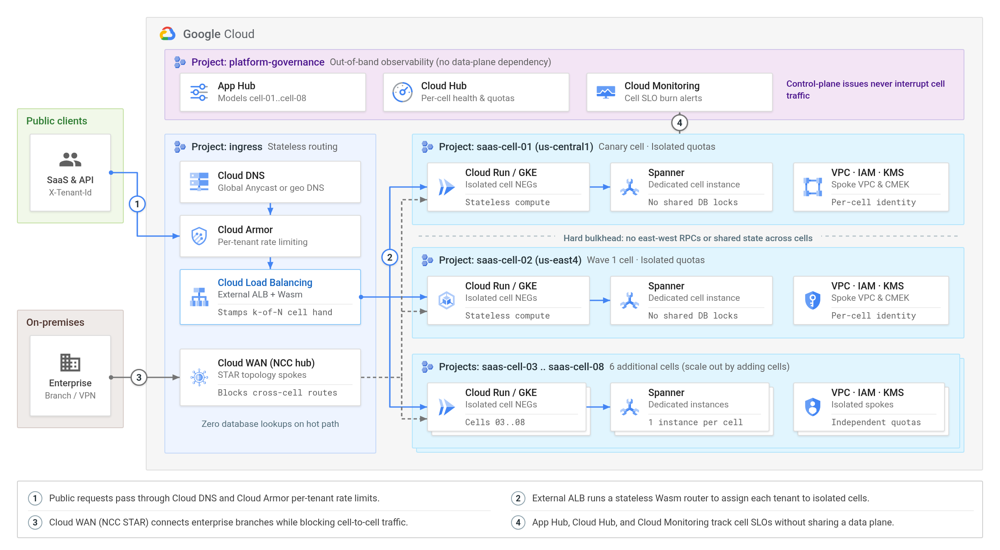
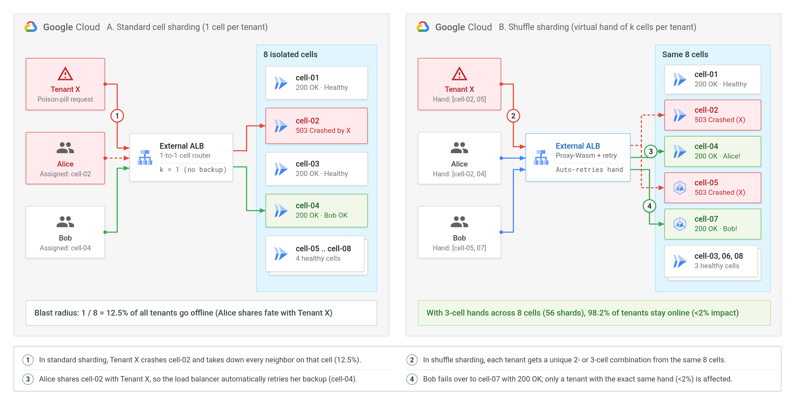
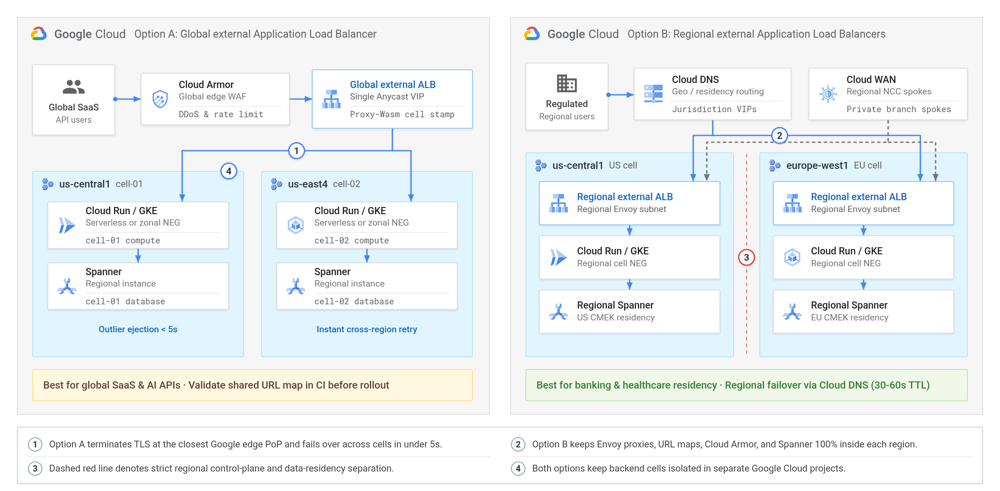
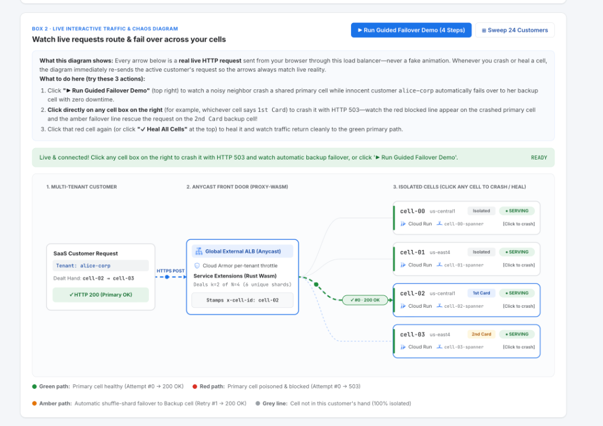
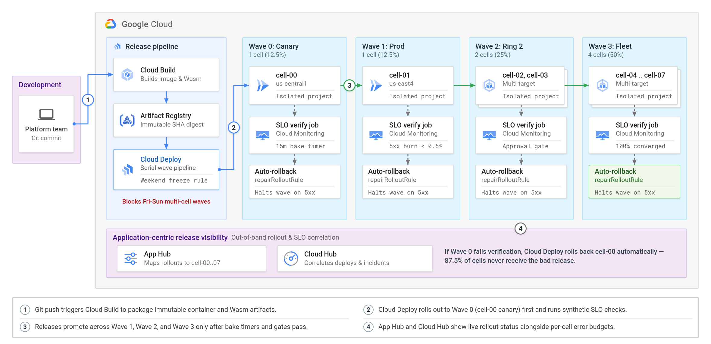
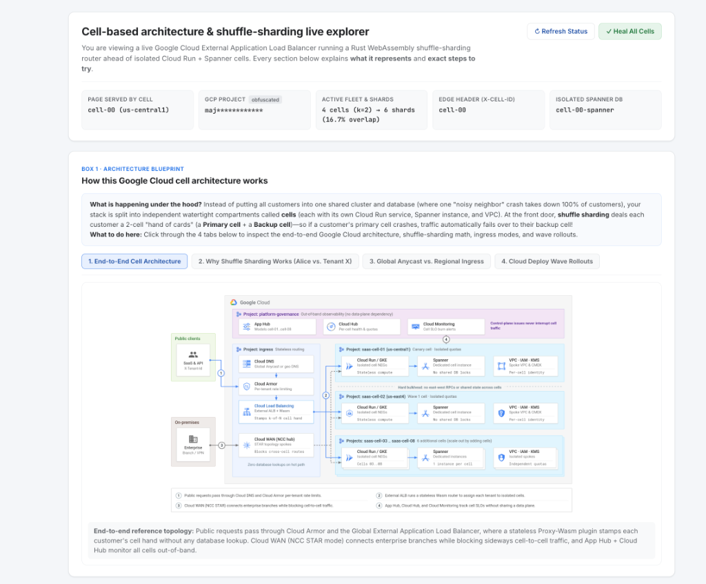
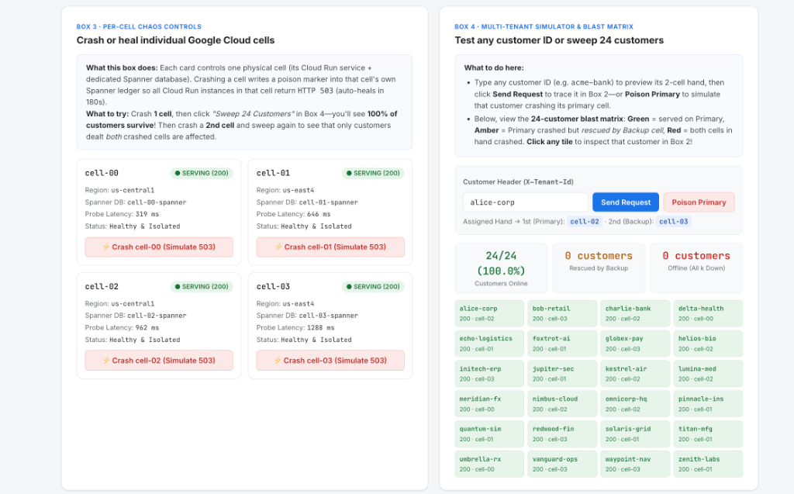
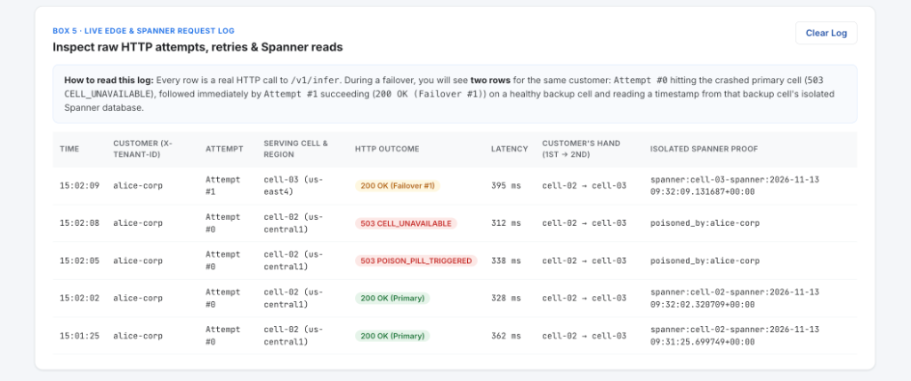

# How to isolate multi-tenant workloads on Google Cloud with cell-based architecture and shuffle sharding

**Authors**  
*[Your Name], [Your Title], Google Cloud*

Picture this: it is 2:00 PM on a Tuesday, and one customer uploads a malformed file—or a routine code push introduces a slow database query—that eats up all available memory and takes down your entire multi-tenant app for every customer at once. Even if you run across multiple zones or regions, sharing one giant cluster and one giant database means a single bug or "noisy neighbor" can still cause a 100% outage.

In this practical guide, you will learn how to divide your Google Cloud workload into independent "watertight compartments" called **cells**, and combine them with a simple card-dealing trick called **shuffle sharding** to keep over 98% of your customers online (`<2%` impact) during a worst-case crash.

First, we will break down how cells and shuffle sharding work in plain English using everyday analogies—no complex math required. Second, we will walk step by step through connecting Cloud Load Balancing, Cloud WAN, Cloud Run, Google Kubernetes Engine (GKE), and Spanner into isolated cells. Third, we will set up safe wave-by-wave releases in Cloud Deploy and monitor all of your cells from a single dashboard using App Hub and Cloud Hub. Finally, you will run a 60-second local test on your own machine to watch customer traffic automatically route around a live "poison-pill" crash.

---

## Understanding the core concepts

### What is a cell-based architecture?

Think about how a modern ship is built. Instead of one giant open hull—where a single leak could sink the entire vessel—engineers divide the hull into **watertight compartments**. If Compartment 2 floods, the doors stay sealed and the other seven compartments keep the ship afloat.

A **cell-based architecture** applies that exact idea to cloud applications. Instead of putting all 1,000 of your customers into one massive Google Cloud project, you stamp out several smaller, identical copies of your stack called **cells** (`cell-01`, `cell-02`, ..., `cell-08`):

* **Complete independence:** Each cell lives in its own Google Cloud project with its own compute (`Cloud Run` or `GKE`), its own database (`Spanner`), and its own network (`VPC`).
* **No sideways traffic:** Cells never call each other directly and never share a database. A runaway query or quota spike in `cell-01` cannot touch `cell-02`.
* **Built-in ceiling on outages:** With 8 equal cells, even if an entire cell goes dark, at least **87.5% of your fleet** keeps running normally.
* **Easy scaling:** When your business grows, you don't have to re-architect a giant cluster—you simply stamp out `cell-09` using Terraform.


*Figure 1. End-to-end cell-based architecture on Google Cloud with a thin routing layer, isolated per-project cells, and unified visibility in App Hub and Cloud Hub.*

### How shuffle sharding stops noisy neighbors like a deck of cards

Splitting your platform into 8 cells already shrinks a total outage from 100% down to **12.5%** (1 out of 8 cells). Still, what if a customer—let's call them **Tenant X**—accidentally sends a "poison-pill" request (like a broken PDF or huge AI prompt) that crashes whichever cell touches it?

If every customer is assigned to just **one** cell, then poor **Alice**, who happens to live on `cell-02` alongside Tenant X, goes completely offline too. You *could* build 50 separate cells to get below a 2% impact, but managing 50 tiny cells is expensive and tedious.

**Shuffle sharding** gets you that 50-cell protection using the **same 8 cells** you already have. Instead of assigning each customer 1 cell, you deal every customer a unique **2-cell or 3-cell "hand of cards"** from your 8 cells:

1. **Tenant X** is dealt `[cell-02, cell-05]` and sends a bad request that crashes both of them.
2. **Alice** was dealt `[cell-02, cell-04]`. Even though `cell-02` is down, Cloud Load Balancing sees the error and automatically retries her backup card—**`cell-04`**—so Alice gets a `200 OK` response without noticing a thing!
3. **Bob** was dealt `[cell-05, cell-07]`. His backup card **`cell-07`** is healthy too, so Bob stays online as well.

Out of 8 cells, there are **56 possible 3-cell hands**. Even if Tenant X crashes all 3 cells in its hand, another customer goes down *only* if they were dealt the **exact same 3 cards**—just **1 out of 56 combinations (1.79%)**:

| Sharding approach | Physical cells you run | Cells in each customer's hand | Unique customer combinations | Customers affected by a poison-pill crash |
| :--- | :---: | :---: | :---: | :---: |
| One big shared cluster | 1 | 1 | 1 | **100.0%** (everyone goes down) |
| Normal cell sharding | 8 | 1 | 8 | **12.5%** (1 in 8 customers) |
| 2-card shuffle sharding | 8 | 2 | 28 | **3.6%** (1 in 28 customers) |
| **3-card shuffle sharding** | **8** | **3** | **56** | **1.8% (`<2%` goal met!)** |
| **2-card shuffle on 12 cells** | **12** | **2** | **66** | **1.5% (`<2%` goal met!)** |


*Figure 2. Comparing normal 1-cell assignment (12.5% impact) with shuffle sharding (<2% impact across the same 8 cells).*

> **Beginner tip — What about databases?** Shuffle sharding is effortless for stateless APIs, web tiers, and AI inference services on `Cloud Run` or `GKE`, because any cell in a customer's hand can process the request right away. For your `Spanner` database tier, start simple: keep each customer's primary data in their first cell (`cell-02`), or replicate asynchronously to their backup cell (`cell-04`) using Spanner change streams if you need instant database failover too.

---

## Implementation steps on Google Cloud

Let's walk through the five building blocks to put this architecture together on Google Cloud.

### Step 1: choose between global and regional external Application Load Balancers

Every cellular architecture needs a thin "front door" that checks who the customer is (for example, from an `X-Tenant-Id` header or JWT token) and forwards the request to the right cell. On Google Cloud, you can pick between two front-door patterns depending on your compliance needs:

* **Option A — Global external Application Load Balancer (best for most SaaS and AI APIs):** Gives you a single global Anycast IP address protected by Cloud Armor. If `cell-02` becomes unhealthy, the load balancer shifts traffic to a healthy backup cell in under 5 seconds—even in another region—without waiting for DNS caches to expire. Just remember to validate changes to your shared URL map in CI before deploying.
* **Option B — Regional external Application Load Balancers (best for strict data residency):** Keeps the load balancer proxies, URL maps, Cloud Armor policies, and Spanner databases 100% locked inside a single jurisdiction (such as `us-central1` for US customers and `europe-west1` for EU customers), using Cloud DNS geolocation policies at the top.


*Figure 3. Choosing between a global external Application Load Balancer (Option A) and sovereign regional external Application Load Balancers (Option B).*

### Step 2: route requests at the edge with Service Extensions and Cloud WAN

A golden rule of cell-based design is **keep the front door as simple as possible**. Avoid making your load balancer query a central SQL or Redis database on every request just to look up which cell a customer belongs to—if that lookup database goes down, every cell becomes unreachable!

Instead, you can compute a customer's 3-cell hand on the fly using a fast, deterministic hash function. Given the same `tenant_id`, the formula **always deals the exact same 3 cells** in microseconds with zero database lookups. Here is the logic in plain Python (in production, our [companion GitHub repository](https://github.com/cmanikandan/gcp-cell-architecture) compiles this exact logic into a tiny **Service Extensions** WebAssembly plugin inside `router-wasm/` that runs directly on Cloud Load Balancing):

```python
import hashlib

def get_customer_cell_hand(tenant_id: str, total_cells: int = 8, hand_size: int = 3) -> list[str]:
    """Deterministically deals a 3-cell 'hand of cards' for a customer without a DB lookup."""
    deck = list(range(total_cells))
    for i in range(hand_size):
        digest = hashlib.sha256(f"v1:{tenant_id}:{i}".encode()).digest()
        pick = i + (int.from_bytes(digest[:8], "big") % (total_cells - i))
        deck[i], deck[pick] = deck[pick], deck[i]
    return [f"cell-{c:02d}" for c in deck[:hand_size]]

# Always returns the exact same 3-cell hand for Alice, anywhere in the world:
print(get_customer_cell_hand("alice"))  # -> ['cell-02', 'cell-04', 'cell-07']
```


*Figure 4. Live traffic view from the deployed Google Cloud POC showing `alice-corp` (`Dealt Hand: cell-02 → cell-03`) routed through Cloud Armor and the Rust Proxy-Wasm Service Extension (`Stamps x-cell-id: cell-02`) to primary `cell-02` (`us-central1`) while backup `cell-03` (`us-east4`) stands by.*

What if your enterprise customers connect privately from corporate offices over VPN or Cloud Interconnect instead of the public internet? Use **Cloud WAN** with **Network Connectivity Center (NCC)** configured in a **`STAR` topology**:

* Put your shared branch/VPN transit network in the **`center` group**.
* Put every cell's VPC (`cell-01-vpc` .. `cell-08-vpc`) in the **`edge` group**.
* Cloud WAN automatically lets offices reach their assigned cells, while **blocking cells from talking to each other**.

[details="Click to view the Terraform snippet for Cloud WAN STAR isolation and load balancer health ejection"]
```hcl
resource "google_network_connectivity_hub" "cloud_wan_hub" {
  project         = var.platform_project_id
  name            = "enterprise-cellular-wan-hub"
  preset_topology = "STAR"
}

resource "google_compute_backend_service" "cell_backend_global" {
  for_each              = local.cells
  project               = var.platform_project_id
  name                  = "${each.key}-global-backend"
  load_balancing_scheme = "EXTERNAL_MANAGED"
  protocol              = "HTTPS"
  security_policy       = google_compute_security_policy.cell_edge_armor.id

  backend {
    group = google_compute_region_network_endpoint_group.cell_serverless_neg[each.key].id
  }

  outlier_detection {
    consecutive_errors = 3
    interval           { seconds = 5 }
    base_ejection_time { seconds = 30 }
  }
}
```
[/details]

### Step 3: build isolated cells with Cloud Run, GKE, and Spanner

Inside each cell's dedicated Google Cloud project, keep the stack clean and repeatable:

* **Compute (`Cloud Run` or `GKE`):** Attach each cell's Cloud Run service (via a Serverless Network Endpoint Group) or GKE Autopilot cluster (via container-native NEGs) to that cell's backend service. Because each cell lives in its own project, an accidental traffic loop in `cell-01` cannot exhaust CPU, IP addresses, or API quotas for `cell-02` through `cell-08`.
* **Database (`Spanner`):** Give each cell its own dedicated Spanner instance (starting as small as 100–300 processing units). Note the difference between **Spanner geo-partitioning** and **dedicated per-cell Spanner instances**: geo-partitioning is great when you want one global database that pins rows by country, whereas separate Spanner instances per cell protect you against a bad schema migration (`ALTER TABLE`) or runaway admin query affecting every customer at once.

### Step 4: roll out updates safely with Cloud Deploy, App Hub, and Cloud Hub

Imagine building 8 beautifully isolated cells—and then pushing a broken container image to all 8 cells at the exact same minute! Your deployment pipeline has to respect cell boundaries too.

With **Cloud Deploy**, you promote releases in **progressive waves** so a bad build stops at the first cell:

1. **Wave 0 — Canary (`cell-00`, 1 cell):** Gets every new release first, followed by an automated health script (`verify = true`) and a 15-minute bake timer. If errors spike, Cloud Deploy's `repairRolloutRule` automatically rolls `cell-00` back—meaning **87.5% of your cells never even see the bad release**.
2. **Wave 1 — Single production cell (`cell-01`, 1 cell):** Confirms the release in a second region.
3. **Wave 2 & Wave 3 — Fleet rollout (`cell-02..03`, then `cell-04..07`):** Deploys to the rest of the fleet in rings, protected by a Cloud Deploy **freeze policy** that blocks multi-cell rollouts on Fridays and weekends.

Finally, managing 8 separate Google Cloud projects doesn't mean clicking around 8 browser tabs during an alert. Register each cell in **App Hub** (`saas-cell-00` .. `saas-cell-07`), and **Cloud Hub** gives your team a single dashboard showing active deployments, quota usage, and SLO alerts broken down cleanly by cell.


*Figure 5. Progressive wave delivery in Cloud Deploy with automated SLO checks, auto-rollback, and unified visibility in App Hub and Cloud Hub.*

[details="Click to view the Cloud Deploy wave pipeline (Terraform)"]
```hcl
resource "google_clouddeploy_delivery_pipeline" "cellular_pipeline" {
  project  = var.platform_project_id
  location = var.primary_region
  name     = "cellular-saas-wave-pipeline"

  serial_pipeline {
    stages {
      target_id = google_clouddeploy_target.cell_target["cell-00"].name
      profiles  = ["canary"]
      strategy  { standard { verify = true } }
    }
    stages {
      target_id = google_clouddeploy_target.cell_target["cell-01"].name
      profiles  = ["prod"]
      strategy  { standard { verify = true } }
    }
    stages {
      target_id = google_clouddeploy_target.wave_2_multitarget.name
      profiles  = ["prod"]
      strategy  { standard { verify = true } }
    }
    stages {
      target_id = google_clouddeploy_target.wave_3_multitarget.name
      profiles  = ["prod"]
      strategy  { standard { verify = true } }
    }
  }
}
```
[/details]

### Step 5: test the proof of concept locally or on Google Cloud

> **Proof-of-concept (POC) & billing notice:** The companion repository ([cmanikandan/gcp-cell-architecture](https://github.com/cmanikandan/gcp-cell-architecture)) is an educational **proof of concept (POC)** intended for learning and architectural evaluation—not a turn-key production deployment. Running the local simulation (`--local-only`) is **100% free ($0)**, whereas deploying to Google Cloud (`--deploy-gcp`) creates live resources and **will incur cloud billing charges**. Because cloud pricing, free-tier quotas, and service features change over time, always refer to the [official Google Cloud documentation](https://docs.cloud.google.com/) and the [Google Cloud Pricing Calculator](https://cloud.google.com/products/calculator) for the latest information before deploying.

You don't need a live cloud account to see shuffle sharding in action. Clone the [cmanikandan/gcp-cell-architecture](https://github.com/cmanikandan/gcp-cell-architecture) repository on GitHub—its local test harness (`deploy_and_test.sh --local-only`) spins up 8 mini cell servers on your laptop at **$0 cost**, runs a local shuffle-sharding load balancer, crashes **Tenant X**'s cells, and proves that **Alice** and **98%+ of 1,000 simulated customers** stay online:

```bash
git clone https://github.com/cmanikandan/gcp-cell-architecture.git
cd gcp-cell-architecture

./tests/deploy_and_test.sh --local-only
```

Sample output:

```text
==> [Part 1] Step-by-step customer failover walkthrough (Alice vs. Tenant X)...
Step 1/4: Starting 8 isolated cell servers (cell-00 .. cell-07) and local load balancer...

Step 2/4: Dealing each customer a 3-cell 'virtual hand' (8 cells -> 56 unique hands):
  - Noisy customer (tenant-x) hand : ['cell-01', 'cell-05', 'cell-03']
  - Normal customer (alice-3) hand: ['cell-01', 'cell-04', 'cell-00']  <-- Shares cell-01 with tenant-x!

  Before crash -> alice-3 request returns HTTP 200 from cell-01

Step 3/4: tenant-x sends a poison-pill payload that crashes all 3 cells in its hand...
  - Crashed cells: ['cell-01', 'cell-05', 'cell-03'] (returning HTTP 503)
  - Remaining 5 cells stay 100% healthy because cells share nothing.

Step 4/4: Sending alice-3's next request through the load balancer...
  -> HTTP 200 OK! cell-01 was down, so the load balancer automatically retried healthy backup cell-04 — alice-3 experienced zero downtime!

==> [Part 2] Running 1,000-customer live HTTP shuffle-sharding benchmark...
[Standard Cell Sharding (N=8, k=1)] -> Surviving: 862/1000 (13.80% outage)
[Shuffle Sharding       (N=8, k=3)] -> Surviving: 981/1000 (1.90% outage  — <2% goal met!)
[Shuffle Sharding      (N=12, k=2)] -> Surviving: 988/1000 (1.20% outage  — <2% goal met!)
```

#### Approximate cost of running the POC on Google Cloud

If you deploy the full **8-cell** multi-project POC (`us-central1` / `us-east4`), the Terraform variables default to minimal POC sizing (`100` Spanner processing units on `STANDARD` edition per cell and scale-to-zero Cloud Run with `min_instance_count = 0`). Expect **~$3 to $5 USD total for a 2-hour hands-on test session**—or **~$1.60/hour (~$1,165/month)** if left running (in **single-project Cloud Shell mode**, `--deploy-gcp` defaults to **4 cells** at roughly half this rate—**~$0.80/hour**—to fit Google Cloud's default 5-VPC per-project quota):

| Google Cloud service | 8-cell POC configuration | Approx. hourly rate | 2-hour POC test | 24/7 monthly rate | Official pricing reference |
| :--- | :--- | :---: | :---: | :---: | :--- |
| **Spanner** | `8` regional `STANDARD` instances × `100` PU (1-hr minimum) | ~$0.76/hr | ~$1.52 | ~$555/mo | [Spanner pricing](https://cloud.google.com/spanner/pricing) |
| **Cloud WAN (NCC)** | `8` VPC spokes on `STAR` hub (+ data transfer) | ~$0.80/hr | ~$1.60 | ~$584/mo | [Network Connectivity pricing](https://cloud.google.com/network-connectivity/pricing) |
| **Cloud Load Balancing & Service Extensions** | `1` global forwarding rule + Proxy-Wasm plugin | ~$0.025/hr | ~$0.05 | ~$18/mo | [Cloud Load Balancing pricing](https://cloud.google.com/load-balancing/pricing) |
| **Cloud Armor Standard** | `1` security policy + `2` rules (prorated) | ~$0.01/hr | <$0.05 | ~$7/mo | [Cloud Armor pricing](https://cloud.google.com/armor/pricing) |
| **Cloud Run, Cloud Deploy, Cloud Build & App Hub** | Scale-to-zero (`min_instances = 0`), 1st pipeline, App Hub | ~$0.00/hr idle | <$0.25 | Usage-based | [Google Cloud Pricing Calculator](https://cloud.google.com/products/calculator) |
| **Estimated POC total** | **Full 8-cell sandbox deployment** | **~$1.60/hr** | **~$3–$5 total** | **~$1,165/mo** | *Tear down right after testing!* |

*Note: All figures above are approximate US list-price estimates excluding network egress and free-tier credits. Always verify current rates in the official Google Cloud pricing pages linked above.*

To deploy the POC into your sandbox project (works directly in **Google Cloud Shell** with zero local Rust or Terraform setup—Cloud Build compiles the `wasm32-wasip1` Service Extension remotely)—and **cleanly uninstall every resource afterward** using `uninstall_gcp.sh` so billing stops immediately:

```bash
export PLATFORM_PROJECT_ID="your-platform-host-project"
export PRIMARY_REGION="us-central1"

# 1. Deploy and test the POC on Google Cloud (4 cells in single-project mode, or 8 cells with cell_project_ids)
./tests/deploy_and_test.sh --deploy-gcp

# 2. Tear down all cloud resources & container images when finished (~$0 ongoing cost)
./tests/uninstall_gcp.sh
```

#### Explore the interactive browser chaos studio

Once `--deploy-gcp` finishes and prints `Anycast Cell Router URL : http://<ANYCAST_VIP>`, open that address in your web browser to launch the built-in **5-box guided cell architecture and shuffle-sharding live explorer**:

* **Built-in architecture blueprint & per-box guides:** Explore all four Google Cloud reference diagrams right inside **Box 1**, with plain-English explanations and step-by-step *"What to do here"* instructions inside every box on the page.
* **Live-synced routing topology:** Watch real HTTP requests flow from your browser through the global external Application Load Balancer and Proxy-Wasm `LbEdgeExtension` into isolated Cloud Run and Spanner cells—automatically re-probing whenever a cell crashes or heals so blocked (`503`) and backup failover (`Retry #1 → 200 OK`) paths always match live cell health.
* **Browser-triggered chaos tests & 24-customer blast matrix:** Click any cell to inject a Spanner-backed poison-pill crash across all Cloud Run instances in that cell (auto-heals after 180 seconds), run the **4-step guided failover demo**, or click any tile in the **24-customer blast matrix** to trace its live failover path and Spanner ledger reads.
* **Built-in project ID obfuscation:** Following public-endpoint security best practices, every HTML view and JSON API response masks `GOOGLE_CLOUD_PROJECT` server-side to only its first three characters (for example, `abc************`) so full project identifiers are never exposed to external clients.


*Figure 6. Opening the deployed Anycast VIP displays the serving cell (`cell-00`), obfuscated project ID (`maj************`), active shard combinatorics (`4 cells, k=2 → 6 shards`), isolated Spanner database (`cell-00-spanner`), and built-in architecture blueprint tabs.*


*Figure 7. Boxes 3 and 4 provide one-click per-cell crash/heal controls across `us-central1` and `us-east4` alongside a live 24-customer blast-radius matrix (`24/24 (100.0%) Customers Online`).*


*Figure 8. Box 5 captures a live poison-pill crash on `cell-02 (us-central1)` (`503 POISON_PILL_TRIGGERED` → `503 CELL_UNAVAILABLE` on `Attempt #0`) followed immediately by automatic cross-region failover to backup `cell-03 (us-east4)` (`200 OK (Failover #1)`) with a verified Spanner commit timestamp (`spanner:cell-03-spanner:...`).*

---

## Real-world application: protecting a multi-tenant SaaS platform on a busy Tuesday

To see how all of these pieces fit together in real life, imagine a team running a document-analysis SaaS platform for 1,000 business customers—including bank branches connecting over **Cloud WAN** and web customers connecting through a **global external Application Load Balancer** across **8 cells** with **3-cell shuffle sharding**.

In a single week, two classic problems hit production:

* **Tuesday morning — A corrupted file upload:** One customer's automated script uploads a malformed 400 MB PDF that triggers an out-of-memory crash. Even as that script retries and knocks out all 3 cells in its hand, **981 out of 1,000 customers keep working without a single failed request** because the load balancer automatically routes around the affected cells while Cloud Armor rate-limits the offending `X-Tenant-Id`.
* **Thursday afternoon — A slow database query in a new release:** A developer accidentally ships a query missing an index. Cloud Deploy rolls the update out to **Wave 0 (`cell-00`)** first. Within two minutes, the verification script spots rising latency, automatically rolls `cell-00` back to the previous version, and highlights `saas-cell-00` in **Cloud Hub**—while `cell-01` through `cell-07` continue serving customers untouched.

---

## Conclusion and next steps

By combining a few practical building blocks on Google Cloud, you can protect your users from both noisy neighbors and bad deployments:

* **Isolate each cell in its own Google Cloud project** with dedicated `Cloud Run` or `GKE` services, dedicated `Spanner` instances, and `Cloud WAN` `STAR` network spokes that block sideways cell-to-cell traffic.
* **Use shuffle sharding at Cloud Load Balancing** so dealing each customer a 2- or 3-cell virtual hand shrinks poison-pill blast radius below **2%** without adding extra servers.
* **Promote releases in waves with Cloud Deploy** and track all of your cells from one place in **App Hub** and **Cloud Hub**.

Ready to try it out for your own workloads?

1. **Try the companion POC and chaos tests:** Clone the [cmanikandan/gcp-cell-architecture](https://github.com/cmanikandan/gcp-cell-architecture) GitHub repository to run the free 60-second local demo—or deploy the POC in a sandbox project (remembering to run `./tests/uninstall_gcp.sh` when finished).
2. **Explore the official reliability guide:** Read the [Google Cloud Architecture Framework: Reliability](https://docs.cloud.google.com/architecture/framework/reliability) and the [official Google Cloud documentation](https://docs.cloud.google.com/) for the latest product capabilities, quotas, and pricing.
3. **Model your first cells:** Group your services into cell boundaries in [App Hub](https://docs.cloud.google.com/app-hub/docs/overview) and monitor per-cell health and rollouts in [Cloud Hub](https://docs.cloud.google.com/hub/docs/overview).
4. **Share your thoughts in the comments:** Have you dealt with noisy-neighbor outages in multi-tenant apps, or are you weighing global vs. regional load balancers for your cells? Drop your questions or experiences below!

### Helpful links and documentation

* Companion POC code, chaos tests & uninstall script on GitHub: [cmanikandan/gcp-cell-architecture](https://github.com/cmanikandan/gcp-cell-architecture)
* [Google Cloud Architecture Framework: Reliability](https://docs.cloud.google.com/architecture/framework/reliability)
* [Google Cloud Pricing Calculator](https://cloud.google.com/products/calculator) and [official Google Cloud documentation](https://docs.cloud.google.com/)
* [Service Extensions overview for Cloud Load Balancing](https://docs.cloud.google.com/service-extensions/docs/overview)
* [Cloud WAN and Network Connectivity Center overview](https://cloud.google.com/blog/products/networking/connect-globally-with-cloud-wan-for-the-ai-era)
* [Cloud Deploy deployment strategies](https://docs.cloud.google.com/deploy/docs/overview)
* [App Hub](https://docs.cloud.google.com/app-hub/docs/overview) and [Cloud Hub](https://docs.cloud.google.com/hub/docs/overview) documentation
