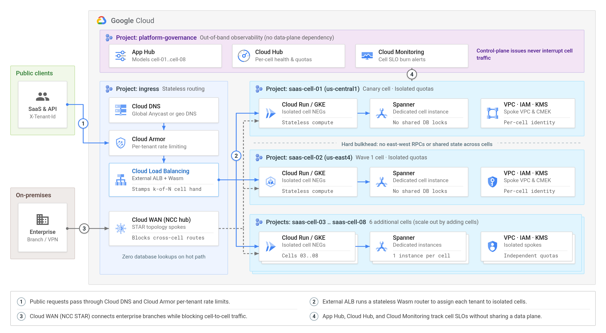
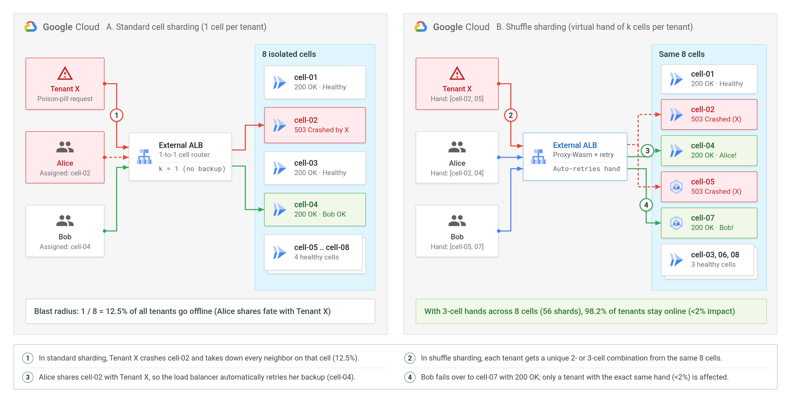
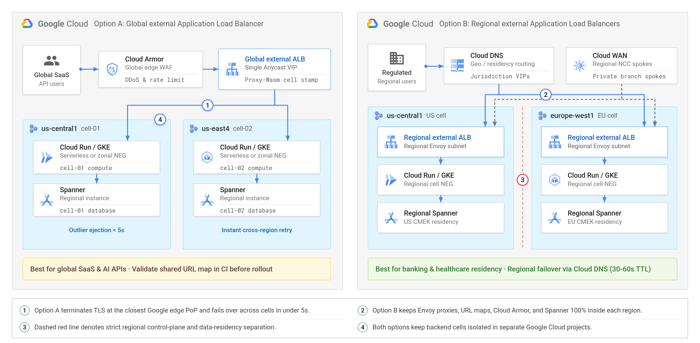
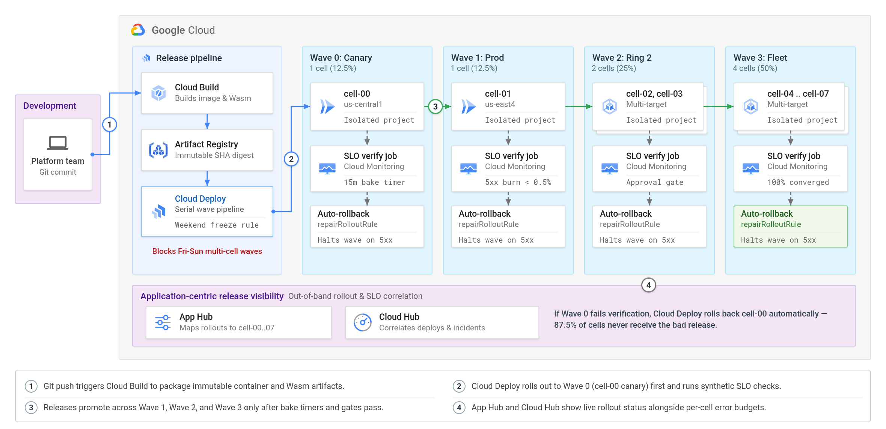

# Cell-Based Architecture & Shuffle Sharding on Google Cloud

[](LICENSE)

Deployable reference architecture, local chaos-testing suite, and diagrams for **isolating multi-tenant workloads on Google Cloud using cell-based architecture and shuffle sharding**.



## What you will find in this repo

Instead of running every customer inside one shared cluster and database—where a single noisy neighbor or bad config push can cause a 100% outage—this project shows how to:

1. **Divide your stack into independent cells** (`1 Google Cloud project = 1 cell`) across **Cloud Run**, **Google Kubernetes Engine (GKE)**, **Spanner**, and **Cloud WAN** (`STAR` spoke isolation).
2. **Contain "poison-pill" customers below a 2% blast radius** using stateless **shuffle sharding** (`Service Extensions` Proxy-Wasm on **Cloud Load Balancing**).
3. **Roll out updates safely wave by wave** in **Cloud Deploy** with automated SLO verification and rollback, while viewing all cells from one dashboard in **App Hub** and **Cloud Hub**.

---

## Quickstart: run the 60-second local demo (no cloud account required)

You can test cell isolation and shuffle-sharding failover right on your laptop using Python 3.10+. The test runner spins up 8 isolated cell HTTP servers, starts a local shuffle-sharding load balancer, crashes **Tenant X**'s assigned cells, and verifies that **Alice** and **98%+ of 1,000 customers** stay online:

```bash
git clone https://github.com/cmanikandan/gcp-cell-architecture.git
cd gcp-cell-architecture

chmod +x tests/deploy_and_test.sh clouddeploy/verify-cell-slo.sh
./tests/deploy_and_test.sh --local-only
```

Want to run just the 4-step beginner walkthrough (**Alice** vs. **Tenant X**)?

```bash
python3 tests/walkthrough_demo.py
```



---

## Deploy to Google Cloud

### Prerequisites

* [Google Cloud SDK (`gcloud`)](https://cloud.google.com/sdk/docs/install) authenticated to a sandbox organization/project
* [Terraform](https://developer.hashicorp.com/terraform/downloads) `>= 1.6`
* [Rust toolchain](https://rustup.rs/) with target `wasm32-wasip1` (`rustup target add wasm32-wasip1`) for compiling the Proxy-Wasm router

### One-command build & deploy

```bash
export PLATFORM_PROJECT_ID="your-platform-host-project"
export PRIMARY_REGION="us-central1"

./tests/deploy_and_test.sh --deploy-gcp
```

To switch between a **global Anycast external Application Load Balancer** (default) and **sovereign regional external Application Load Balancers** (for strict data residency), set `ingress_mode = "regional"` in `terraform/variables.tf` or pass `-var="ingress_mode=regional"`.



---

## Repository structure

```text
.
├── router-wasm/              # Rust Proxy-Wasm Service Extension (stateless k-of-N shuffle router)
├── cell-service/             # Cell HTTP backend (Spanner client, Dockerfile, GKE NEG manifest)
├── terraform/                # ALB, Cloud WAN (NCC STAR), Cloud Run/GKE, Spanner, Cloud Deploy, App Hub
├── clouddeploy/              # Skaffold profiles & post-deploy SLO verification gate script
├── tests/                    # Step-by-step failover demo & 1,000-tenant live HTTP chaos benchmark
├── diagrams/                 # Google Cloud Architecture Center style PNG diagrams & generator
├── DISCUSS_GOOGLE_DEV_POST.md# Companion technical blog article for discuss.google.dev
├── AGENTS.md                 # Instructions and architectural invariants for AI coding agents
└── LICENSE                   # MIT License
```



## License

Released under the [MIT License](LICENSE).
